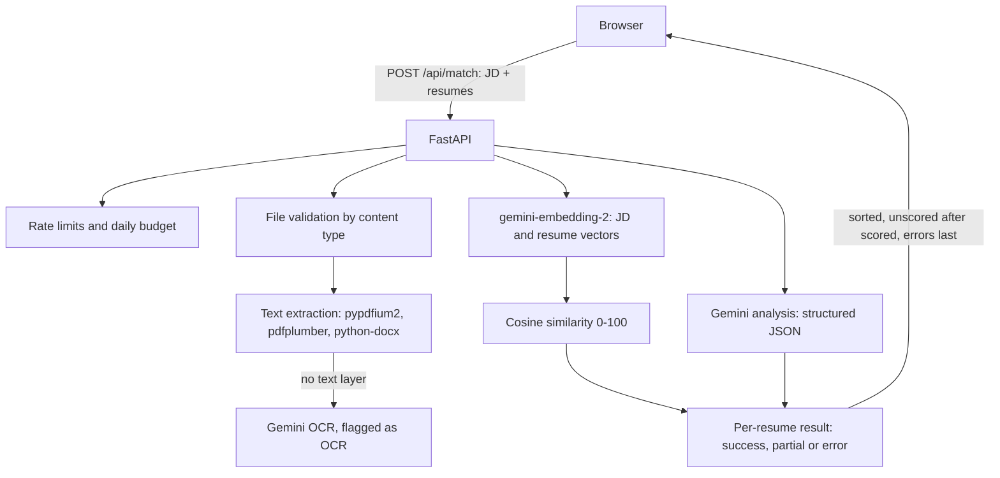

# HireIntel 🎯
### AI-assisted resume review: similarity scoring plus evidence-based strengths and gaps

HireIntel helps a recruiter look through a batch of resumes for one job. You paste a job description (or a short job title), upload resumes, and for each resume HireIntel shows:

- a **similarity score** (0–100) between the job description and the resume, computed from text embeddings;
- an **AI-written analysis**: a short summary, requirements the resume shows evidence for, requirements with no evidence found, and points to verify with the candidate;
- the **extracted text**, so you can check what the system actually read.

### Requirement mode (evidence per requirement)

Click **Extract requirements to check** after pasting a job description:

1. The AI proposes a checklist of requirements, each marked **mandatory** or **preferred**. Conditions a resume can't show (citizenship, documents, shift availability, relocation) are listed separately as *not checked from resumes*.
2. You edit the list: reword items, change importance, delete them or add your own.
3. Each resume is assessed against every confirmed requirement in one AI call. Each requirement gets one of three states:
   - **Evidence found**: the AI quoted the resume, and the quote was **found in the extracted text** by HireIntel's own check.
   - **Needs review**: the evidence is ambiguous, the AI's quote could not be found in the text, or part of the resume was cut.
   - **No evidence found**: nothing in a complete, readable resume mentions it. This is not proof that the candidate lacks it.
4. Candidates are grouped into bands by their mandatory requirements: **B1** all supported, **B2** some need review, **B3** no evidence for one, **B4** no evidence for two or more. Within a band, more supported preferred requirements come first. **No band rejects anyone.**

A verified quote proves the words exist in the resume. It doesn't prove the AI interpreted them correctly, so the quotes are shown for you to judge.

> **This is a portfolio demo, not a hiring tool.** Results are suggestions for a human reviewer. The similarity score is not a probability of fit, and the AI analysis can be wrong. HireIntel never rejects anyone automatically.

---

## 📋 Problem

Recruiters reviewing many resumes run into a few recurring problems that HireIntel tries to make visible:

1. **Keyword matching misses synonyms.** "Backend Software Engineer" and "Python Developer" can describe the same person. Embeddings capture some of that similarity.
2. **A single score explains nothing.** HireIntel pairs the score with requirement-level evidence and gaps.
3. **Scanned resumes have no text.** PDFs without a text layer and image resumes go through AI text recognition (OCR), and the result is labelled as OCR output.
4. **LLMs get dates wrong.** The current year is passed to the model so it can calculate graduation and experience dates correctly.

## 🧭 Design principles

- **Failures are never disguised as results.** If scoring or analysis fails, the resume is marked `partial` with a visible warning. It never shows "0%" or a made-up analysis.
- **"No evidence found" is not "lacks the skill".** Gaps are worded as missing evidence in the resume text.
- **Resume text is treated as data.** The text is fenced off in the prompt, and the model is told to ignore and report any instructions hidden in a resume. The sample `kavya_python_intern.txt` contains such an instruction so you can see this in action.
- **Honest limits.** Long resumes that had to be cut, and OCR output that hit its length limit, are flagged.

---

## 🛠️ Tech stack

| Layer | Technology |
|---|---|
| Frontend | Vanilla HTML, CSS and JavaScript, served by the backend from the same origin |
| Backend | FastAPI, Uvicorn, Python 3.12 |
| AI | Google Gemini API via the `google-genai` SDK: `gemini-3.5-flash-lite` for analysis and OCR (falling back to `gemini-3.8-flash`), `gemini-embedding-2` (768 dimensions) for similarity |
| Documents | `pypdfium2` and `pdfplumber` for PDFs, `python-docx` for DOCX |
| Quality | pytest, ruff, GitHub Actions |

Model IDs are configuration, not code (`app/config.py`), so a retired model can be replaced without a code change.

## 📐 Architecture



Each resume is processed independently (4 at a time). One bad file can't break the batch. Scoring and analysis for a resume run concurrently.

### Data handling

- Files are processed in memory per request and are **not stored** by HireIntel. There is no database. The web server may briefly buffer uploads over 1 MB in a temporary file while receiving them.
- **All resume text is sent to Google's Gemini API.** On the free tier, Google may use submitted content to improve its products and humans may review it ([Gemini API terms](https://ai.google.dev/gemini-api/terms)). That is why the public demo asks for **sample or made-up resumes only**.
- Logs record counts, statuses and error types, never resume or job description text.

---

## 🔒 Public demo protections

| Protection | Default | Setting |
|---|---|---|
| Requests per client per minute | 3 | `RATE_LIMIT_PER_MINUTE` |
| Requests per client per day | 20 | `RATE_LIMIT_PER_DAY` |
| Resumes processed per day (all users) | 150 | `DAILY_RESUME_BUDGET` |
| Files per request | 10 | `MAX_FILES` |
| Size per file | 5 MB | `MAX_FILE_SIZE_MB` |
| Optional access code | off | `DEMO_ACCESS_CODE` |
| Cross-origin calls | blocked | `CORS_ORIGINS` |

Oversized requests are rejected before the body is read. File types are checked from the file's content, not just its extension. Legacy `.doc` files are rejected with a clear message. Limits are kept in memory and reset when the server restarts, which is fine for a single-instance demo.

---

## ⚙️ Run locally

**Prerequisites:** Python 3.12+ and a Gemini API key from [Google AI Studio](https://aistudio.google.com/).

```bash
git clone https://github.com/ShreyasHegde0105/HireIntel.git
cd HireIntel

python -m venv .venv
# Windows: .\.venv\Scripts\Activate.ps1    macOS/Linux: source .venv/bin/activate
pip install -r requirements-dev.txt

cp .env.example .env    # then put your GEMINI_API_KEY in .env

uvicorn app.main:app --reload
```

Open http://127.0.0.1:8000 and click **Load sample job & resumes**, then **Analyze and Rank**. API docs are at http://127.0.0.1:8000/docs.

### Tests and lint

```bash
pytest -q
ruff check .
```

The tests use a fake Gemini client, so they need no API key and cost nothing. They cover the failure rules: a failed embedding never becomes a score and is never cached, failed analyses are never faked, temporary overloads are retried, bad files are rejected, and limits are enforced.

---

## 🚀 Deploy (Render free tier)

The repository includes `render.yaml` and a `Dockerfile`. The container runs as a non-root user, honours `$PORT`, and has a health check at `/health`.

1. In Render, create a **Blueprint** from this repository (or a Docker web service).
2. Set `GEMINI_API_KEY` in the service's environment. Optionally set `DEMO_ACCESS_CODE`.
3. Deploy. The frontend and API are served from the same URL.

The free tier sleeps after 15 minutes without traffic. The first request after that can take about a minute while it wakes up; the frontend waits up to 3 minutes.

CI (`.github/workflows/ci.yml`) runs lint and tests on every push, then builds the Docker image and checks that `/health` responds.

---

## ⚠️ Known limitations

- The similarity score is uncalibrated cosine similarity. Scores for related resumes often cluster closely (for example 65–80), so compare candidates within one run rather than reading the number as an absolute grade.
- The analysis is a single LLM pass per resume and can miss or misread evidence. In requirement mode, quotes are checked against the extracted text, but they are not yet highlighted in the original document.
- "No evidence found" covers both "not mentioned" and "the resume shows something different" (e.g. a B.Sc. against a required B.Tech); the note explains which.
- DOCX text boxes are not read yet. Resumes laid out with text boxes may lose content.
- Response time depends on Gemini. On the free tier the model is sometimes overloaded; affected resumes are then shown as `partial` with a warning.
- No accounts, history or persistence. Re-running costs another round of API calls.

## 🗺️ Next steps

- Show the original PDF beside the evidence, with verified quotes highlighted.
- Let the recruiter override a requirement state, with a reason.
- Read DOCX text boxes, headers and footers.
- Build a small labelled evaluation set to measure how often requirement states agree with human reviewers.
